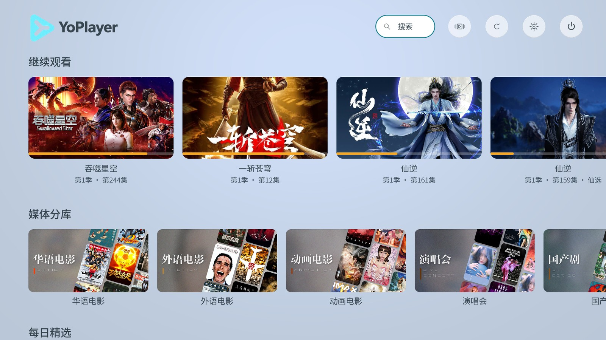
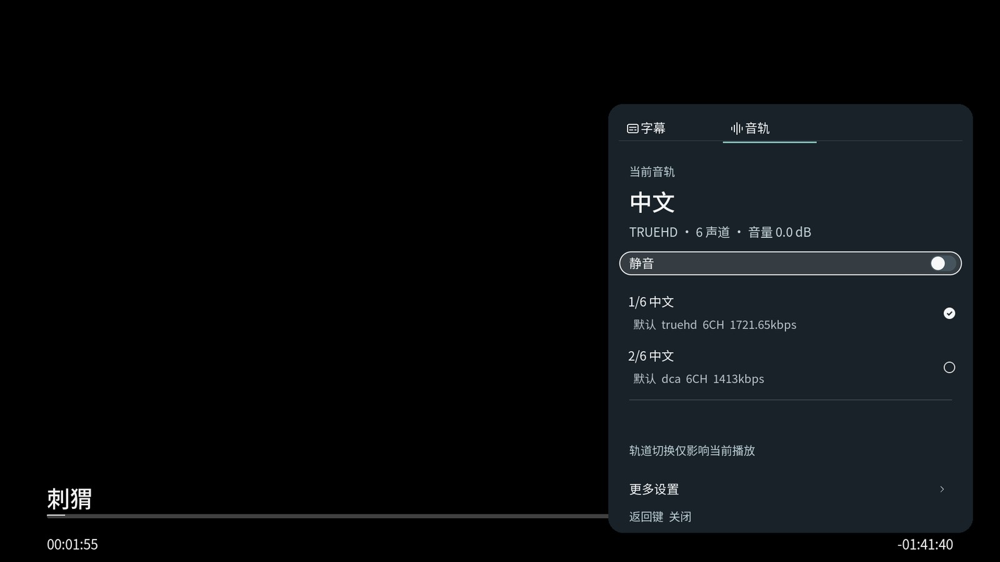
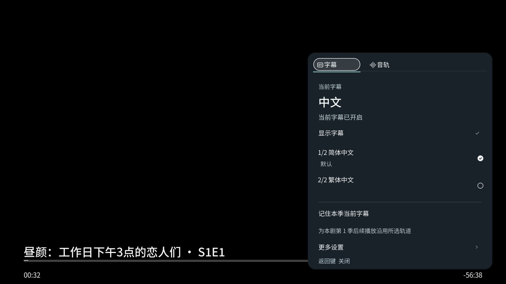

# YoPlayer


面向电视和遥控操作的 Kodi 媒体界面，包含 **YoPlayer · Infuse 皮肤**和**首页数据组件**。单首页集中展示分库、继续观看、最近添加和播放历史，保留 Kodi 原生播放与设置能力。

当前源码：**Skin 2026.10.3.117 / Home 1.0.37**，严格基于115，不包含116的视觉改动。117已于2026-10-15安装到CoreELEC，限定测试部分通过，仍有两项P2未通过；不是完整验收。

最新公开下载：**[Skin 2026.10.3.117 / Home 1.0.37](https://github.com/yyhoworks/YoPlayer/releases/tag/v2026.10.3.117)**，附件复用已核验的CE交付原包。117保留115的电影类型、剧集类型、未观看分区及设置页5+5布局，调整确认框用途、详情/预告片生命周期、精确身份续播、异步详情数据、空态与字体角色。确认框初始焦点及无播放时预告片错误提示仍未通过，见[117限定测试报告](docs/github/VALIDATION117.md)。

[安装说明](INSTALL.md) · [下载 Releases](https://github.com/yyhoworks/YoPlayer/releases) · [主题配色](docs/github/THEMES.md) · [VI 手册](docs/vi/README.md) · [界面预览](docs/github/PREVIEW.md) · [开发说明](docs/github/DEVELOPMENT.md) · [近期更新](docs/github/CHANGELOG.md)

## 界面预览

首页集中展示继续观看、媒体分库和推荐栏目。

[](docs/github/previews/home.jpg)

| 电影详情 | 剧集详情与选集 |
|---|---|
| [](docs/github/previews/movie-detail.jpg) | [](docs/github/previews/series-detail.jpg) |

| 播放中的音轨选择 | 播放中的字幕选择 |
|---|---|
| [](docs/github/previews/player-audio.jpg) | [](docs/github/previews/player-subtitles.jpg) |

[查看全部 10 张预览](docs/github/PREVIEW.md)，包括海报墙、播放前音轨选择、播放信息、皮肤设置和首页栏目管理。

以上预览来自 CoreELEC 实机，采集于 Skin 58–64 版，展示当时的布局和播放功能；不代表115或117的最新外观，也不是117验收证据。各页采集版本见完整预览，最新变化见更新说明。远程截图中的视频层可能显示为黑色。

## 可以做什么

- **浏览真实分库**：复用 Kodi / Emby 已有节点，调整首页栏目与分库显示，过滤隐藏分库。
- **继续观看与搜索**：使用真实续播位置、观看记录和最近添加内容，不另建观看历史。
- **电影与剧集详情**：统一详情、评分、选季选集和当前播放信息。
- **音轨与字幕**：资料可靠时支持播放前预选、播放中切换和“记住本季”；无法唯一确认时保留原选择。
- **遥控导航**：焦点、快捷菜单、设置和播放控制适配电视操作，保留 CoreELEC 原生设置。
- **列表加载优化**：评分采用单次列表的批量只读校验，完整条目一次提交，保留顺序、播放地址和续播。
- **主题配色**：皮肤设置里的“界面显示 → 主题配色”可预览与保存五种预设。海报、剧照和播放画面保持原色，经典延续原默认及既有偏好。

轨道预选、评分和 Emby 已看同步依赖来源及接口。已验证的 Emby Next Gen 接口版本为 **11.1.27**，详见[兼容性与限制](docs/github/COMPATIBILITY.md)。

## 快速安装

1. 从 [117 Release](https://github.com/yyhoworks/YoPlayer/releases/tag/v2026.10.3.117) 下载 `YoPlayer-Home-1.0.37.zip` 和 `YoPlayer-Skin-2026.10.3.117.zip`，核对同页的 `SHA256SUMS.txt`。
2. 在 Kodi“插件 → 从 ZIP 文件安装”中先安装 Home，再安装 Skin。
3. 在“设置 → 界面 → 皮肤”选择 **YoPlayer · Infuse**。

已有片库可继续使用。升级前备份用户配置，不需要重新扫描或清库。更多步骤和返回键说明见 [INSTALL.md](INSTALL.md)。

## 仓库结构

```text
source/
  skin.yoplayer.infuse/          皮肤 XML、脚本、字体与图片
  plugin.video.yoplayer.home/    首页、分库、搜索和评分组件
tools/                          离线检查和打包入口
docs/github/                    使用、开发、发布和版本说明
docs/vi/                        最新单一 VI 手册与权威 PNG
.github/                        Actions 与问题模板
```

设备备份、数据库、观看样本、部署日志、历史归档和安装 ZIP 留在本地或 Releases，不进入 Git。原版 `baseline/` / `reference/` 在维护者工作区保持原字节，全新克隆可独立检查和打包。详见[仓库与发布](docs/github/PUBLISHING.md)。

## 开发

只需 Python 3.10+，无需启动 Kodi：

```bash
python tools/check_infuse_structure.py --repository
python tools/package_project.py --repository
```

117应先运行不带参数的专项离线检查。ZIP 输出至 `dist/`，不覆盖已有文件；打包前还会核对各工作区的标准同版本交付档案。117已打包并安装，本次GitHub同步不再打包。提供同一仓库检查的 [GitHub Actions 模板](docs/github/offline-workflow.yml)，当前尚未启用。完整维护者工作区另有历史参考回归，两种范围见[开发说明](docs/github/DEVELOPMENT.md)。

## 验证范围

117通过44项专项离线回归（含115交付成员比对、控件几何指纹、结构与伪Kodi检查）。2026-10-15实际目标为Kodi21.3-Omega-f10 / CoreELEC21.3-Omega_avdvplus_F10_20261008173739，已完成停态差量安装和成员读回。设置导航、背景播放保护、续播/音轨/字幕菜单取消等限定路径通过；确认框初始焦点、无播放时预告片错误提示仍未通过。具体证据边界见[117限定测试报告](docs/github/VALIDATION117.md)，离线通过和115历史证据都不能替代当前CE验收。

ISO/多版本实际续播、在线预告片、真实Emby片头/片尾分支、播放中切轨与本季记忆写入等仍待补验。当前原生截图全黑，不能作为电视黑屏或视觉通过的证据；字体主题、电视观感和实体遥控/CEC留待人工确认。Windows仅作辅助，本次117未连接或更新其安装。最终验收尚未完成。授权码、在线更新暂缓；开机画面另行完成，不随插件包分发。

## 来源与许可

项目以 Infuse Skin 2026.10.2.12 / Home 1.0.6 为起点，基于 Minsk Infuse 和 Kodi Confluence，保留 Minsk、Jezz_X、Kodi Team 及上游贡献者署名。

皮肤沿用 GNU GPL v2，Home 声明 GPL-2.0-or-later；字体、图标等遵循独立许可。见 [LICENSE](LICENSE)、[第三方说明](THIRD_PARTY_NOTICES.md)和源码许可。本项目与 Firecore 的 Infuse 产品没有官方关联。
