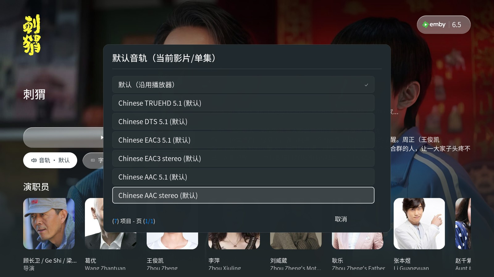
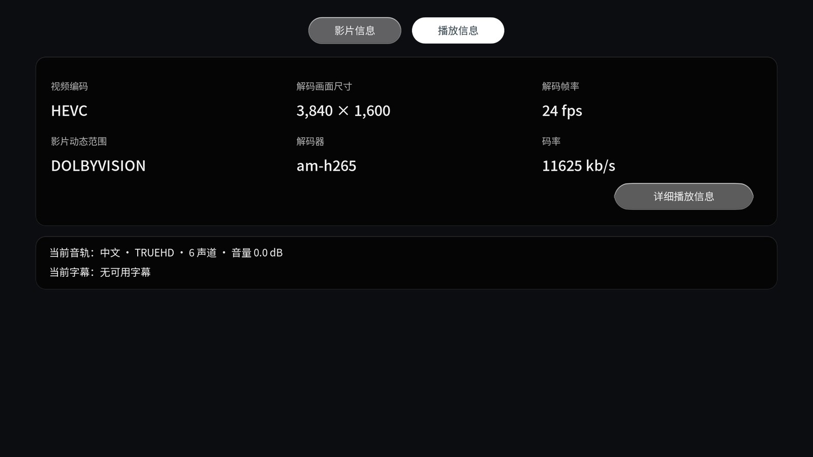
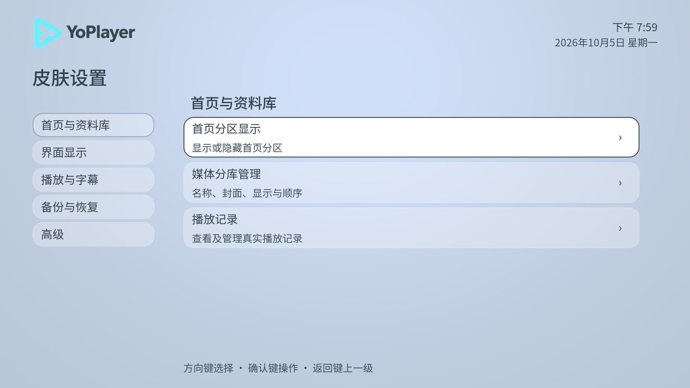
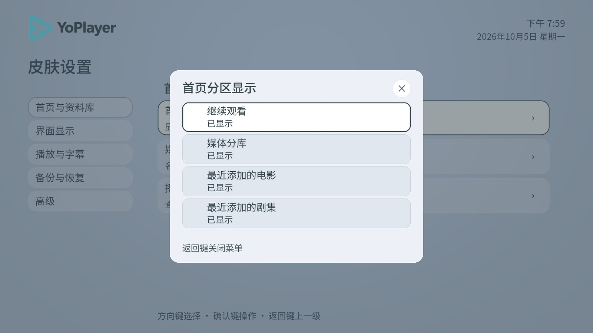

# YoPlayer 界面预览

[返回项目首页](../../README.md) · [安装说明](../../INSTALL.md) · [下载 Releases](https://github.com/yyhoworks/YoPlayer/releases)

以下 10 张图片均来自 CoreELEC 上的 YoPlayer 实机截图，展示首页、媒体浏览、详情和播放控制。图片保留完整画面，统一缩放为 1600 × 900，并转换为 JPEG 以便浏览。

截图采集于 Skin 2026.10.3.58–64，展示当时的布局与功能；当前发布为 90 / Home 1.0.28，后续 VI、主题、玻璃、详情及播放控件已有变化，这些历史截图不代表最新版外观。各页注明实际采集版本。片名、评分、轨道和解码信息来自当时的媒体样本，会随自己的片库与播放来源变化。最新变化见[更新说明](CHANGELOG.md)，品牌素材见[VI 手册](../vi/README.md)。

部分 CoreELEC 视频层无法被远程截图捕获，因此播放面板后的黑色区域不表示电视上的视频画面为黑色。截图用于展示界面，不替代实体电视、HDR、硬解、遥控或 CEC 验证。

## 首页

继续观看、媒体分库和推荐栏目集中在同一首页，上方提供搜索和常用操作。

采集版本：Skin 2026.10.3.62。

## 海报墙

剧集海报与名称按网格排列，右上方提供菜单、视图、排序和搜索入口。

采集版本：Skin 2026.10.3.62。

## 电影详情

背景、简介、评分、媒体规格和演员集中展示，可从详情页播放或选择音轨与字幕。

采集版本：Skin 2026.10.3.62。

## 剧集详情与选集

同一页面展示剧集简介、季与分集列表，当前选集对应播放入口。

采集版本：Skin 2026.10.3.61。

## 播放前音轨选择

可靠的来源资料可用于播放前选择音轨。此处展示选择列表；预选是否可用依赖来源接口，详见[兼容性说明](COMPATIBILITY.md)。

采集版本：Skin 2026.10.3.61。

## 播放中的音轨选择

侧边面板展示当前语言、音频格式、声道、音量与可选音轨，并提供静音和更多设置。

采集版本：Skin 2026.10.3.64。

## 播放中的字幕选择

字幕面板保留字幕开关、语言列表和“记住本季当前字幕”。字幕开关与当前选轨分别显示自己的状态。

采集版本：Skin 2026.10.3.64。

## 播放信息

播放信息页显示当前编码、分辨率、帧率、动态范围和解码器，并汇总音轨与字幕状态。

采集版本：Skin 2026.10.3.64。这里的硬件及动态范围字段是播放器当时报告的值，截图不能证明实体电视的显示效果。

## 皮肤设置

设置按首页与资料库、界面显示、播放与字幕、备份与恢复、高级分组，低频操作集中在对应页面。

采集版本：Skin 2026.10.3.58。

## 首页栏目管理

首页分区可以按需要显示或隐藏；图中使用较大的 Massive 字体档位。

采集版本：Skin 2026.10.3.58。

界面中的媒体海报、背景与剧照仅用于展示片库效果，相关权利归各自权利人。程序、字体和图标的来源及许可见[第三方说明](../../THIRD_PARTY_NOTICES.md)。
